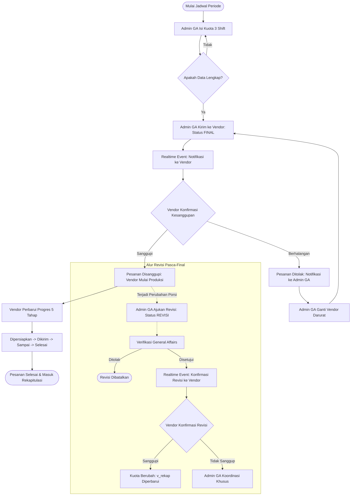
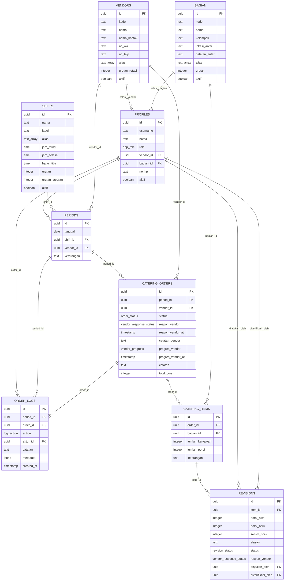

# Dokumentasi Teknis Sistem
### Sistem Pengelolaan Data Catering Karyawan - PT Terminal Petikemas Surabaya (Pelindo TPS)

Dokumen ini mendokumentasikan arsitektur teknis perangkat lunak, diagram alur sistem, Entity-Relationship Diagram (ERD), katalog stored procedure, arsitektur keamanan, mesin impor data cerdas, dan mekanisme notifikasi realtime.

---

## 1. Stack Teknologi & Metodologi

Sistem dirancang dengan arsitektur enterprise modern berbasis TypeScript dari antarmuka hingga lapisan server:

- **Frontend Core**: Next.js 16 (App Router, React 19) dengan Server-Side Rendering (SSR) dan Server Components untuk pemuatan halaman instan.
- **Styling**: Tailwind CSS v4 berbasis token warna resmi korporat Pelindo TPS (Primary `#0A4D7C`, Background `#F0F4F8`, Border `#D9E2EC`, Text `#1A202C`).
- **Database**: PostgreSQL 15 di platform Supabase dengan Row Level Security (RLS) ketat dan Stored Procedures atomik (`SECURITY DEFINER`).
- **Realtime Engine**: Supabase Realtime via PostgreSQL Replication (`supabase_realtime` publication, `replica identity full`, WebSocket channels).
- **Format Ekspor**:
  - Spreadsheet: `exceljs` untuk menghasilkan berkas Excel bergaris kisi dan sel gabungan (*merged cells*).
  - Dokumen Resmi: `jspdf` dan `jspdf-autotable` untuk dokumen PDF A4 Landscape ber-kop resmi.
- **Mesin Impor Berkas**:
  - Deterministik: Parser aturan mandiri berbasis buffer in-memory untuk XLSX/CSV (`exceljs`), DOCX (`mammoth`), dan PDF (`pdfjs-dist`).
  - OCR Engine: `tesseract.js` terisolasi pada sisi peramban web (*client-side web worker*) untuk dokumen hasil pindai (*scanned PDF/gambar*).
  - AI Engine: Fallback opsional Gemini 2.5 Flash via `@google/genai` (bawaan: dinonaktifkan).
- **Pengujian & Kualitas**: Vitest untuk pengujian unit logika murni, ESLint flat config, dan TypeScript strict.

---

## 2. Diagram Alur Operasional Sistem (Mermaid)

Alur kerja pesanan katering harian 3 shift digambarkan dalam diagram alir berikut:

---

## 3. Entity-Relationship Diagram (ERD) Basis Data

Struktur tabel relasional basis data PostgreSQL didokumentasikan dalam diagram Mermaid berikut:

---

## 4. Katalog Stored Procedures (RPC Atomik)

Semua mutasi transaksi katering dijalankan secara eksklusif melalui prosedur tersimpan PostgreSQL (`SECURITY DEFINER`) untuk menjaga integritas dan isolasi hak akses:

| Nama Fungsi RPC | Pemanggil Resmi | Deskripsi & Validasi Integritas |
| :--- | :--- | :--- |
| `simpan_catering` | Admin GA | Menyimpan draf porsi 3 shift (*dirty cell tracking*). Hanya menulis sel yang berubah. |
| `kirim_catering` | Admin GA | Memvalidasi seluruh bagian terisi, mengunci status periode ke `final`, dan mengirim ke vendor. |
| `ganti_vendor_periode` | Admin GA | Mengubah vendor jadwal atau vendor pengganti darurat dengan alasan wajib dan log audit. |
| `ajukan_revisi` | Admin GA | Mengajukan revisi porsi pasca-final dengan alasan wajib. Kolom historis dijaga immutable. |
| `verifikasi_revisi` | Admin GA | Menyetujui atau membatalkan revisi kuota. Jika dibatalkan, catatan verifikator wajib diisi. |
| `respon_periode_vendor` | Vendor | Vendor menyatakan kesanggupan (`disanggupi`) atau menolak (`tidak_sanggup`) dengan alasan wajib. |
| `respon_revisi_vendor` | Vendor | Vendor menyatakan kesanggupan atas revisi porsi yang diajukan GA. |
| `update_progres_vendor` | Vendor | Memajukan tahapan pengiriman 5 tahap satu arah (*menunggu -> dipersiapkan -> dikirim -> sampai -> selesai*). Menolak transisi mundur. |
| `konfirmasi_impor` | Admin GA | Memproses konfirmasi batch impor dokumen secara atomik, menyinkronkan periode, membuat vendor otomatis opsional, dan memproteksi periode status non-draft. |
| `dashboard_ringkasan` | Admin GA | Menghasilkan ringkasan KPI, tren harian, porsi per shift, per bagian, dan per vendor dalam satu panggilan sinkron (maksimal 366 hari). |
| `get_rekap_harian` | Admin GA | Mengembalikan matriks porsi per bagian aktif dan per shift secara terpaginasi (*server-side pagination*). |
| `get_rekap_ringkasan` | Admin GA | Menghasilkan agregasi 4 dimensi (per bagian, per shift, per vendor, per bulan) dari view konsumsi valid `v_rekap`. |
| `get_notifikasi` | Admin & Vendor | Mengembalikan 10 notifikasi tertarget teratas, tautan tindakan, dan badge counter aktif per role. |

---

## 5. Arsitektur Keamanan & Proteksi Akses Data

1. **Prinsip Hak Akses Terkecil (*Principle of Least Privilege*)**:
   - Hak `INSERT`, `UPDATE`, `DELETE` pada tabel transaksi dicabut (*REVOKE*) dari peran `authenticated` dan `anon`. Seluruh penulisan transaksi hanya melalui RPC atomik.
2. **Pencegahan Eskalasi Hak Akses (*Role Escalation Protection*)**:
   - Kolom `role`, `vendor_id`, `aktif`, dan `username` pada tabel `profiles` dijaga oleh database trigger `trg_guard_profiles_update` yang menolak manipulasi oleh akun non-service-role.
   - Kebijakan RLS update pada `profiles` hanya mengizinkan modifikasi kolom `nama` untuk profil milik pengguna sendiri.
3. **Isolasi Penuh Vendor**:
   - Fungsi `public.my_vendor_id()` mendeteksi vendor pemilik sesi.
   - Seluruh kueri dan langganan WebSocket Realtime dibatasi oleh RLS sehingga vendor Aisya (V001) tidak dapat membaca pesanan maupun revisi milik vendor lain.
4. **Log Audit Append-Only**:
   - Tabel `order_logs` menerapkan RLS `USING (false)` untuk perintah `DELETE` dan `UPDATE`, menjamin kronologi rekam jejak tidak dapat dihapus atau dimanipulasi oleh siapapun.
5. **Header Keamanan Web**:
   - Berkas `next.config.ts` menyertakan `X-Content-Type-Options: nosniff`, `X-Frame-Options: DENY`, `Referrer-Policy: strict-origin-when-cross-origin`, `Permissions-Policy`, dan `X-XSS-Protection`.

---

## 6. Mesin Impor Data Cerdas (Multi-Format)

Sistem mengadopsi prinsip **Mesin Deterministik sebagai Prioritas Utama**:
1. **Validasi Magic Bytes**:
   - Memeriksa penanda byte awal berkas sebelum membaca isi (ZIP header `PK\x03\x04` untuk XLSX/DOCX, `%PDF` untuk PDF).
2. **Ekstraksi Matriks**:
   - XLSX/CSV: Resolusi sel gabungan (*merged cells*) dan pembacaan formula yang telah tersimpan (*cached value*). Batas maksimum 5.000 baris.
   - DOCX: Ekstraksi tabel tabular dan sel paragraf melalui `mammoth`.
   - PDF Berteks: Ekstraksi koordinat teks per halaman melalui `pdfjs-dist`.
   - PDF/Gambar Pindaian (*Scanned*): OCR otomatis dijalankan pada browser peramban melalui `tesseract.js` worker tanpa mengirim berkas dokumen ke pihak ketiga.
3. **Deteksi Otomatis Jenis Dokumen**:
   - Menganalisis header kolom dan pola isi untuk mengidentifikasi 4 kategori: `jadwal` (rotasi shift vendor), `vendor` (master mitra), `bagian` (master divisi), atau `rekap_harian`.
4. **Pencocokan Fuzzy & Normalisasi**:
   - Menghilangkan tanda baca dan spasi ganda.
   - Pencocokan alias pada tabel master (contoh: "siang" otomatis cocok ke Shift 1).
5. **Review Tabel Interaktif Sebelum Tulis**:
   - Pengguna dapat mengoreksi nilai sel berstatus `perlu_cek` atau `error` langsung di tabel antarmuka sebelum mengonfirmasi penyimpanan permanen ke basis data.

---

## 7. Arsitektur Realtime & Notifikasi

1. **Koneksi WebSocket Efisien**:
   - Klien menggunakan koneksi singleton browser Supabase client untuk berbagi satu channel WebSocket antar-komponen.
2. **Hook `useRealtimeTable`**:
   - Mendengarkan event perubahan data (`INSERT`, `UPDATE`, `DELETE`) secara selektif.
   - Menyertakan *cleanup* otomatis saat komponen unmount untuk mencegah kebocoran memori langganan.
   - Mekanisme *reconnection handler* otomatis memicu pembaruan data server ketika koneksi internet pulih.
   - Debounce bawaan 300ms mencegah rendering berulang jika menerima banyak event dalam waktu singkat.
3. **In-Place Row Updating**:
   - Komponen tabel operasional memperbarui baris terkait secara *in-place* di memori komponen, menjaga posisi halaman, pilihan filter, dan posisi scroll pengguna tetap utuh tanpa *full page reload*.
